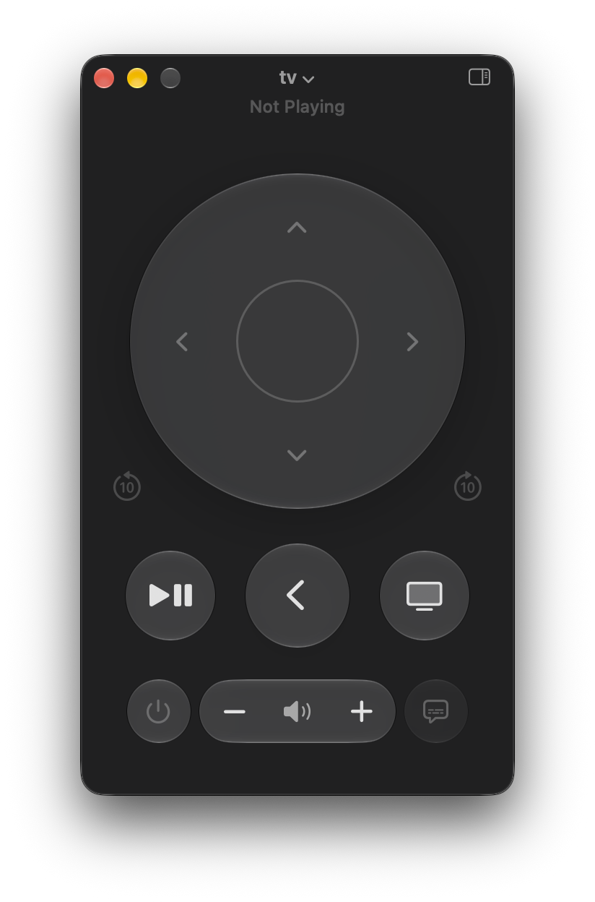

# remotetv

an apple tv remote as a mac app
- supports keyboard control, including typing into text boxes and media keys
- shows now playing info with a scrubber
- sidebar showing artwork, up next, and an app launcher
- also adds `tvctl`, a cli for using the remote
- focused on performance & reliability. zero dependencies

